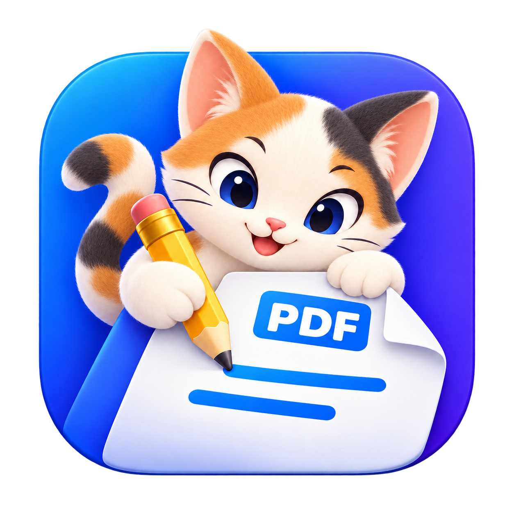
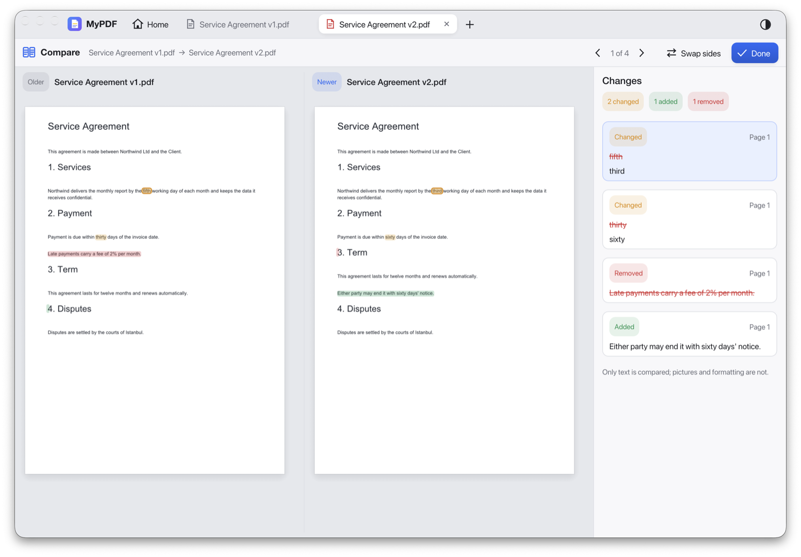
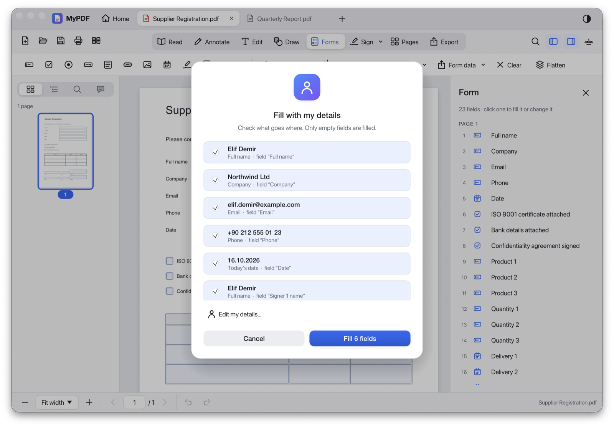
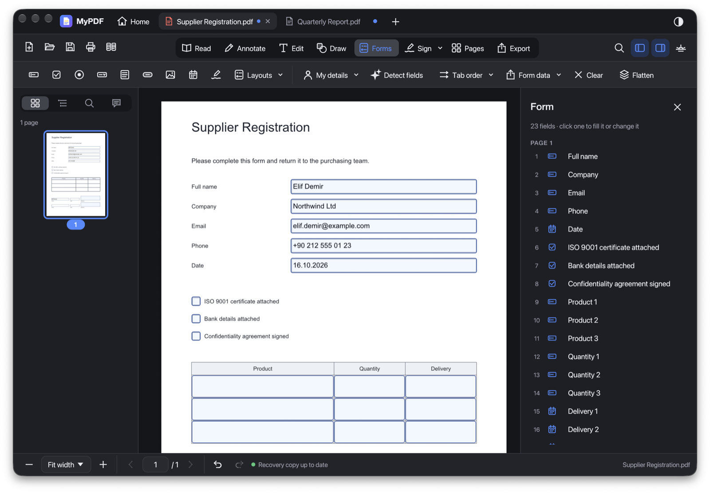
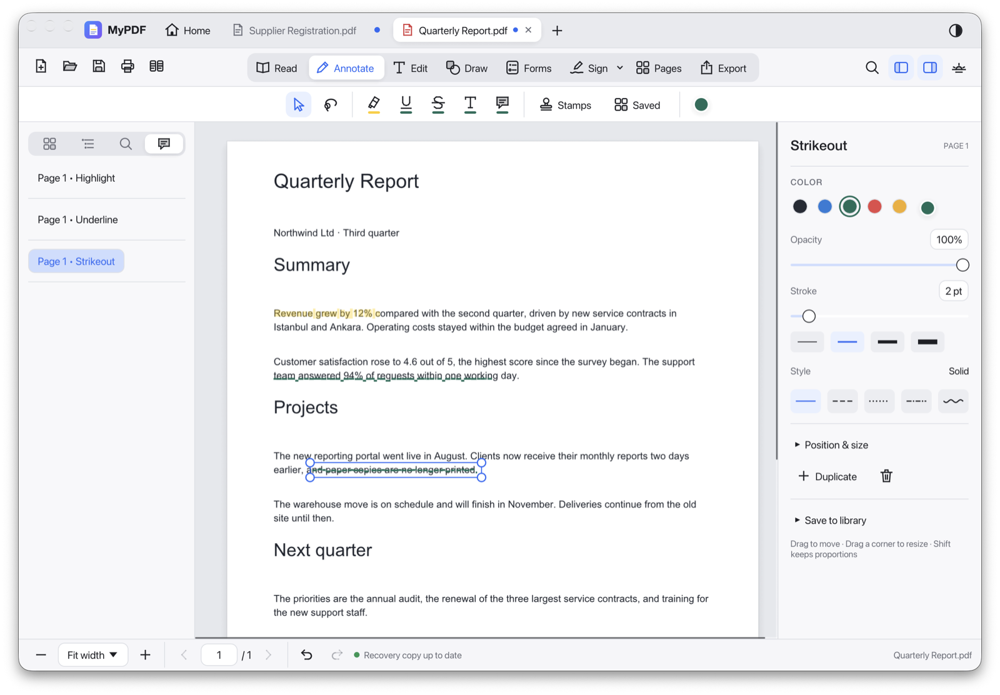
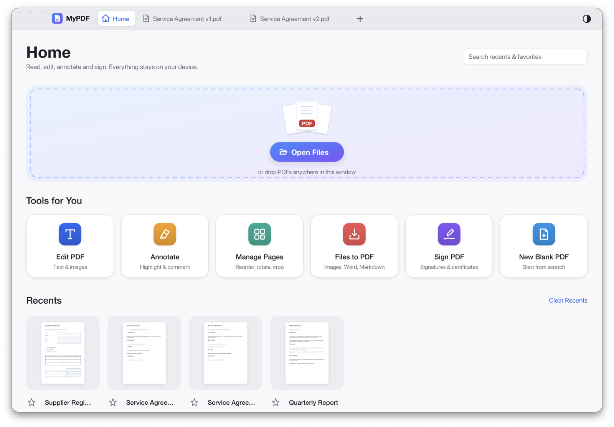

# MyPDF — native Rust desktop PDF editor

Version **2.1.0**, build **177**, adds vector-sharp digital signatures, editable tables and compact drawing controls. Tables support movable or embedded placement, bordered-table detection, cell editing, row/column sizing, five templates, merge/split, spreadsheet paste and fitting row heights to contents.

Hover over **Line**, **Arrow**, **Rectangle** or **Ellipse** to choose a variation. Lines and arrows offer independent start/end heads and size controls; drawing properties include live previews and pattern fills. Annotate includes Pen, squiggly underlines, notes and bookmarks from selected text. Edit selects supported text and images automatically while preserving the chosen mode. A compact Export ribbon groups Word, Text, Markdown and Image; advanced options stay in the side panel. **Open** has a hover menu for Open, Save and Save As, Compare Documents is in Tools, and application menus have contextual icons.

Version **2.0.0**, build **166**, fixed Repeat on pages with a window-sized thumbnail grid, click-to-select destinations, Select all/Clear, synchronized page ranges and previews loaded as you scroll. The source page is skipped and one Undo removes all copies.

Version **2.0.0** also adds a compact reusable-style manager with previews, purpose filters, custom-style editing and two protected built-in styles. Color controls offer standard swatches and a tidy RGB/hex picker without expanding the surrounding interface. Settings sub-tabs are easier to distinguish, and recovery restores edits made to signed PDFs while preserving signed revisions and retaining failed copies for retry.

Version **1.6.0** adds Graphite, Glacier and Calico visual styles, three icon-color options, and grouped signature settings. Digital signing, signature removal and undo/redo preserve the reading position and keep page images visible while updating. Page reordering also retains its thumbnails. Version **1.5.2** fixes copying embedded signature images, pasting signatures into the ink-signature creator, and deleting active text boxes. Version **1.5.1** fixes tab dragging in normal Mac windows, keeping window movement separate from document reordering. Version 1.5.0 adds compact document tabs with drag reordering, searchable overflow, contextual actions and named tab groups. About now credits Orhan Gökçöl. Version 1.4.1 moved workflow tools into the Tools menu and distinguished same-name signing certificates with IDs and expiry details. Version 1.4 added nearby text-style matching, optional table/baseline guides, equal object spacing and sizes, document templates, local batch processing, and sharing-copy cleanup. New text boxes fit one line and grow or shrink with their contents. Native Rust, local files, no WebViews. Published **Mac app for Apple Silicon** and **Windows x64 installer** downloads are available from [Releases](https://github.com/gokcol/MyPDF/releases).

> MyPDF was built with the help of Claude, Anthropic's AI assistant, to make everyday business paperwork easier. It is provided as is, without warranty of any kind: keep copies of important documents and use it at your own risk.

## New in 1.4

- **Add text → Match surrounding text** explicitly copies the nearest text's size, color and a matching installed font. Unavailable fonts use an installed substitute. It affects the new block, not surrounding page content. **Fit height to text** starts at one line, grows for wrapping/newlines and shrinks after deletion; resizing manually keeps your chosen minimum height.
- **Workflow Settings → Snap to detected table edges and text baselines** enables page-content guides. Object movement also requires the ribbon's existing Snap toggle. Added text uses the setting directly; hold Option/Alt while moving it to bypass guides. Scanned table lines are not detected. Guides are local and never change the PDF.
- **Select multiple objects → right inspector** offers equal horizontal/vertical gaps and Same width/height/size. Size matching uses the first selected object in document order, preserving centers. An arrangement that would exceed the page is rejected. Each action is one Undo step.
- **Tools menu** groups Document Templates, Batch Processing, Prepare Copy for Sharing and Workflow Settings in a pull-down menu, without an extra icon row. These commands are also available through Find a Tool.
- **Document Templates** (Tools menu or Find a Tool) saves a local reusable copy with pages, forms, placed artwork and the current Add text style. Templates can be renamed or deleted. **New copy** opens an unsaved document; the library template remains unchanged. Signed/encrypted documents must first be made into an editable unsigned copy.
- **Batch Processing** combines on-device OCR (macOS), compression, bottom-center page numbering and text watermarks for up to 50 saved PDFs. Preview one of the selected files, then choose a different output folder. Inputs and existing outputs are never overwritten. Files are processed sequentially, with per-file results and cancellation between operations; OCR also supports cancellation during recognition. Windows has compression, numbering and watermarks, but no OCR.
- **Prepare Copy for Sharing** reviews removal of notes/comment text, embedded attachments and document/annotation metadata. Visible drawings, highlights, page text and form values remain. Removing comments/metadata also removes MyPDF's private object-editing data so deleted comments cannot reappear. This is **not redaction**: page content, form values, bookmarks and hidden layers remain. Review the full output before sending it. The source and its Undo history stay unchanged.

All three copy workflows work locally. Batch recipes, placement preferences and templates are saved in MyPDF's application data folder alongside, without replacing, existing settings and artwork.

## Screenshots

Taken from the running app on macOS, with made-up sample documents (`cargo run --release --example demo_docs -- <folder>` creates them).

**Compare Documents:** two versions side by side, with changed (amber), removed (red) and added (green) words marked and listed.



**Fill with my details:** your saved name, company, email and phone go into the empty fields that ask for them, after a look at what goes where.



**Forms, in the dark theme:** the filled form with its fields listed in tab order on the right.



**Annotate:** highlight, underline and strike out text; every mark is listed on the left and its colour, opacity and stroke are on the right.



**Home:** open or drop files, start a common task, and pick up recent documents.



- **Home:** Open/drop PDFs, create a blank PDF, launch common tools, and browse local Recents and Favorites with page previews.
- **Edit:** type directly on blank or existing pages; click existing text to edit it in place; explicitly select a rectangle to edit several lines while retaining their layout; replace, reposition, resize and delete existing page-level images.
- **Forms:** build forms with text, check box, radio, dropdown, list box, button, image, date and signature fields; detect fields on paper-style forms; fill, clear, flatten, set tab order, and import or export data as FDF, XFDF or CSV.
- **Export:** PNG/JPEG ↔ PDF; PDF ↔ Markdown, text and Word `.docx` using text-oriented conversion.
- **Everyday:** print, an outline sidebar, clickable links, password-protected PDFs, reducing file size, recognizing the text of scans (OCR), and watermarks.
- **SVG:** Annotate → Stamps → Saved → SVG code; paste code, preview, save and place. Select placed artwork to move, resize, rotate, recolor or edit its SVG source.
- **Context menus:** icon-led commands match the clicked text, drawing, stamp, image or empty page. Transform, Style and Arrange groups keep object menus compact. Right-click inside a live text editor preserves the selected characters for Cut, Copy, Paste and Delete. Locked objects and read-only documents keep their editing restrictions.
- **Smarter selection:** with Select active in Edit, click supported base-PDF text or images to reach the appropriate editing controls. Draw and Annotate select managed artwork without switching into Edit. Read mode keeps text-selection behavior. **Select Behind** cycles overlapping artwork at the clicked point.
- **Reusable styles:** copy/paste appearance from the object menu or save a named style in the inspector. Text styles apply to selected characters, or the whole block when there is no selection; drawings copy appearance without copying position or content. Settings → Reusable styles provides previews, search, type/purpose filters, and compact editors with visual stroke choices. Rename, duplicate, edit or delete custom styles, with Undo for deletion. Review outline (drawing) and Document heading (text) are protected built-ins; use Customize a copy to personalize them. Existing customized samples remain user styles. Saved-style edits do not change existing PDF objects.
- **Persistent groups:** select multiple artwork objects and choose **Arrange → Group objects**. Selecting a member selects its group; copies have independent group identities. Ungroup is available in the same menu. Groups survive saving/reopening in MyPDF.
- **Direct transforms:** drag the rotation handle above a selected drawing/image; hold Shift for 15° steps. Crop image layers directly on the page, with corner handles and percentage controls; Enter accepts and Escape cancels. Each gesture is one Undo step.
- **Workspace:** File → Workspace controls restoring file-backed tabs, page positions, zoom and panels on startup. **Reopen Closed Tab** (⇧⌘T) restores the most recently closed file. Unsaved documents remain handled separately by Document Recovery.
- **Document tabs and groups:** Tabs shrink to fit and show scroll arrows when needed. The compact **down arrow** searches the current group's filenames and folders and lets you close individual files. Drag tabs to reorder them; right-click for file location, close, reopen, and **Move to Group…** actions. Right-click anywhere in the tab strip to switch, create, rename or remove working sets such as Work. The current named group appears in small bold text below the arrow; Ungrouped adds no label. Each group remembers its tab order and active document; Ctrl+Tab stays within that group. Removing a group moves its documents to **Ungrouped** without closing them. Bulk closing affects only the current group and keeps the normal save prompts.
- **Review:** File → Review Comments opens annotation replies, resolved status, author/color/status filters and CSV summary export. Threads belong to MyPDF annotations and persist in the PDF's MyPDF metadata; other readers can display the combined comment text but do not necessarily expose the thread controls.
- **Navigation:** edit bookmarks and page-label sections from the outline sidebar or File menu. Renaming bookmarks retains existing destinations and zoom. Undo/Redo jumps to the affected page and briefly outlines changed artwork.
- **Artwork workflow:** Paste shows a movable preview; click to place or press Escape to cancel. **Edit → Paste in Original Position** (⇧⌘V) preserves the source placement.
- **Crop and restore:** select an image layer → **Crop image…** in the right inspector. Drag the crop corners, keep the aspect ratio, adjust percentage edges, trim white/transparent margins, or restore the full original. Pixels are retained in the PDF; cropping is not redaction.
- **Objects:** the existing **Marks** sidebar now has artwork thumbnails, editable names, visibility, locking and stacking controls. **Repeat on pages…** previews a chosen page range and adds all copies as one Undo step. These tools operate on MyPDF artwork layers; use **Copy region** to turn base-PDF artwork into one first.
- **Find a tool:** ⌘K (Ctrl+K on Windows) opens searchable tools with aliases such as “transparent,” “crop,” and “merge.” **View → Document History** browses Undo/Redo states for the current session. **View → Show / Hide Editing Guides** controls selection outlines without changing the saved PDF; unselected base images show an outline only on hover.
- **Blank PDF:** File → New Blank PDF (⌘N/Ctrl+N). **Blank page:** Pages → Blank Page.

## Private translation (1.2.0)

Select text and right-click **Translate selected text**. For a whole page, click **Translate** beside Search in the toolbar, then **Translate page** at the top of the right panel. **Edit → Translation** also opens these tools. Results appear in the right panel beside the PDF, with an expandable original, language selectors, Copy, and cancellation. Translation leaves the PDF unchanged until you explicitly choose **Attach translation as note**. This creates an undoable note beside the selected text (or a page note for a whole-page translation); save the PDF to keep it. The note opens immediately in the right panel. Click its speech-bubble icon later to read, edit, or copy the full translation, including after reopening the PDF. Note edits support Undo/Redo. It never replaces the original text. Changing the document, page, or unrelated committed edits discards the previous result.

On **macOS 26 or later**, translation uses Apple's installed on-device models. Choose **Download languages…** when a pair is missing; only this download step opens a native consent window. Translation requests cannot request downloads and have no cloud fallback. **Read scanned page** uses local OCR without modifying the PDF. Earlier supported macOS versions can still use the PDF editor, but cannot use this translation backend.

On **Windows x64**, translation uses a bundled native **CTranslate2 + SentencePiece** runtime, without Python or a web service. Initial offline packs cover **English ↔ Turkish, German, French and Spanish**. These are direct pairs; other combinations are reported as unsupported. Downloading a pack is an explicit action and checks its pinned size and SHA-256 hash. After installation, inference loads only local models. See [the native translation runtime](native/translation-ct2/README.md) for model sources, licenses, build and test instructions.

Use **Add / manage languages** to browse the provider's supported languages and keep favorites at the top of the menus. Language preferences and downloaded models are stored locally. Original and translated text stay in memory unless you explicitly attach the result as a note or copy it; MyPDF saves no separate translation history and sends no document content to a server. Copy places the result on the system clipboard only when requested. Apple may collect language and usage metrics, but not the original or translated text. See the [privacy policy](PRIVACY.md).

In **Edit → Edit text** or **Select area**, drag the handle above the selected text block to move it. The text and selection border move together. Finish with **Done**, a click outside, or **⌘Return**; **Esc** cancels the draft. Undo while a moved edit is still open restores the original text and position together, and Redo restores the edited, moved block. Unsupported PDF text structures leave the original content unchanged.

Every edit is undoable. Selected drawing properties stay in the right inspector, keeping the page and selection handles unobstructed. Rotate by **±90°**, enter an arbitrary angle, or **flip horizontally/vertically**; changes apply immediately, support Undo/Redo, and survive saving. **Settings → Ink signatures → New ink signature… → Image** accepts a PNG or JPEG through **Choose image…** or an image copied from another app through **Paste image** (⌘V on Mac when a text field isn't focused). PNG transparency is preserved; **Remove background…** can remove a paper background locally. Choose **Save & place**, move the preview to the desired spot, and click. Afterwards, drag the signature to adjust its position or use its corner handles to resize it. Escape cancels placement; Undo/Redo applies to the placed signature. You can also choose **Sign → Sign in ink** in the ribbon, choose your artwork, and click its desired position on the page. The signature remains in the local library for reuse. Without an editable document open, **Save signature** only saves it to the library.

**Export → Multiple pages per sheet…** (also in the macOS File menu) creates a fresh PDF with grid presets from 1×1 through 4×4, or custom grids up to 8×8. Set the sheet size/orientation, four margins, spacing, optional source-edge trimming, headers/footers with `{page}` and `{pages}` sheet numbers, and a text watermark with angle and opacity. The preview shows each output sheet. Text and drawings stay vector-based; annotation and form appearances become page content, and digital signatures remain only in the original. Unsupported annotations without saved appearances are reported instead of silently omitted. Source trimming clips content, so it is not redaction. Existing files are never replaced.

Save named **export presets** in this dialog to reuse sheet dimensions, grid, margins, trimming, headers/footers and watermark settings. Presets are local; page ranges stay specific to the current document.

**Save As…** lets you keep the original by choosing another filename. Word/Markdown conversion does not reconstruct complex layouts, and existing-text editing has font/object compatibility limits. See [milestone 6 results](MILESTONE6_RESULTS.md) and [milestone 5 compatibility limits](MILESTONE5_RESULTS.md).


A native Rust desktop PDF viewer and annotation/signing editor, macOS first and portable to Windows. The interface uses egui/eframe and winit, with Metal on macOS and DirectX 12 on Windows. It contains no WebView, HTML interface, browser renderer, or JavaScript application runtime.

Milestone 1 adds document tabs, a continuous page canvas, lazy thumbnails, Unicode text search with positioned highlights, page navigation, fit modes and zoom, native Open/Save dialogs, drag and drop, and macOS menus. Each tab retains its page, scroll position, zoom and search query during the session. Parsing, indexing, search and PDF rasterization run on background threads.

Milestone 2 adds a digital identity manager, personal certificate creation, authenticated `.p12`/`.pfx` import and encrypted export, public-certificate inspection, native macOS Keychain identity selection, visible/invisible approval signatures, and offline validation. Signature appearance supports a page rectangle, identity name, reason, location, and reusable artwork.

Milestone 3 adds highlights, underlines, strikeouts, pen strokes, notes, Unicode text boxes, shapes, lines/arrows, symbols, stamps, drawn/typed visual signatures, and a local PNG/JPEG/SVG asset library. Select, move, resize, rotate, style, duplicate or delete your annotations; Undo/Redo tracks document edits. Saved annotations use standard PDF subtypes and appearance streams.

Milestone 4 adds a thumbnail page organizer with drag reordering, multi-selection and page ranges, blank/PDF insertion, deletion, extraction, multi-file merging, splitting every N pages, clockwise/counterclockwise rotation, and crop margins with a live preview and reset. Page changes and annotations share one Undo/Redo history. Rendering and text search refresh after each page transaction.

MyPDF’s compact interface combines dark document tabs, a grouped annotation ribbon, and a fixed right-hand library. **Annotate → Stamps** opens a searchable panel containing built-in vector artwork and 26 standard stamps, including solid directional arrows, double/elbow arrows, chevrons, colored checks and crosses, stars, warnings, information symbols and stamps. Select an item and click the page, or drag the item from the panel straight onto the page (a faint preview shows where it lands). **Select** reveals the inspector. Drag any of the four round corner handles to resize: symbols, stamps, drawings and imported artwork keep their proportions, and shapes do too with Shift. The pointer is an open hand over a movable mark and a closed hand while moving it. Your existing saved artwork remains available.

**Dock and taskbar shortcuts:** on macOS, right-click MyPDF in the Dock to switch between open PDFs, with tab groups in compact submenus and recent PDFs kept separately. On Windows, the taskbar Jump List shows group headings, recent PDFs, and Open/New tasks within the space Windows allows. Selecting an already-open PDF activates its existing tab and group. No extra toolbar icons are added.

**Save** (⌘S / Ctrl+S) atomically updates the current file. New, imported and recovered documents ask for a destination on their first save. **Save As…** (⇧⌘S / Ctrl+Shift+S) lets you choose a name, confirms replacement through the native dialog, and adopts the chosen file as the document. Hover over the Open folder icon to access Open, Save and Save As without extra toolbar buttons. An external change or read-only file stops Save with an explanation; Save As can preserve both versions. Saving preserves the exact opened bytes when there are no applied changes. Unsaved changes prompt on close. Signed/certified PDFs open protected; **Enable editing…** in the signature bar unlocks them, and every save then appends your edits after the signed bytes (see *Signed PDFs* below). New certificate signatures also append revisions while preserving earlier bytes. Page tools reject encrypted PDFs. Form fields stay with their pages: reordering moves them, deleting a page removes its fields, and inserted or pasted pages bring theirs (a clashing name gets " (2)"). Cropping hides content; it does not redact it. Existing-text editing, form filling and local conversions are available in the Edit, Forms and Export panels.

In **Pages**, click a thumbnail, use ⌘/Ctrl-click or Shift-click for multiple pages, or enter a range such as `1, 3-5`. Drag to the left/right half of a thumbnail to insert the selection before/after it, or use **Move before page**. **Insert** accepts a blank page or PDF files at a chosen position; **Merge** appends PDFs. **Copy pages** (⌘C) copies the selected pages, with their annotations. Switch to any other open PDF and choose **Paste pages** (⌘V) to insert them after its selected page (or at the end); the pasted pages become the selection, and Undo removes them. You can copy from a signed or read-only PDF too; the copies are not signed, so signature fields are left behind. **Extract** saves selected pages. **Split** exports the whole document into a fresh folder, using the interval in the right panel. **Crop** previews displayed-page margins in points and applies them to the selected pages.

## Version 1.11 updates

Version 1.11 adds local background removal for placed images, imported signature images, and saved digital-signature artwork. A transparency preview offers background color, tolerance, soft edges and optional edge-connected removal. PDF edits support Undo; signature-library changes retain the original artwork. This is intended for paper/solid backgrounds, not arbitrary photographic subject extraction.

New and existing text blocks share the right-hand inspector (font, style, size, alignment, color, position and width). Font size offers a slider, common-size dropdown, smaller/larger buttons and exact entry. Position and width also offer sliders. Preserved text regions offer first-line indentation and line spacing; spacing changes retain proportional paragraph gaps and save as real PDF text with Undo support. Selected characters receive font/style/size/color changes; surrounding text keeps its formatting. With no character selection, formatting applies to the block. Alignment remains a block setting. The redundant floating text toolbar has been removed. Mixed formatting survives alignment changes and PDF saving. For placed images and image signatures, the inspector offers live opacity, reversible blur, border color/width/style, rotation and flipping. Original image pixels are retained in MyPDF metadata; blur is a visual effect, **not redaction**. Existing embedded PDF images have an appearance preview for opacity, blur and a solid border, applied to a new image with document Undo support.

Pen/signature input preserves intermediate pointer samples delivered in a single frame, and multi-touch navigation cancels pending page strokes.

A standalone **native iPad development preview** is in [ipad/README.md](ipad/README.md). It shares the Rust engine and uses SwiftUI/PDFKit/PencilKit for the device interface. It is not yet feature-equivalent to the desktop application or included in the desktop release downloads. Full parity remains the required goal in [ipad/PARITY.md](ipad/PARITY.md).

## Copy artwork that is not a separate PDF image

In **Edit → Images → Copy region**, drag around a logo, illustration or scanned detail, preview the result and choose **Add image layer**. The copy opens in the drawing inspector with movement, resizing, rotation, flipping, background removal, opacity, blur and border controls. Everything inside the rectangle, including any text, becomes a raster image; the rest of the PDF is unchanged. Choose 150, 200 or 300 DPI (large regions are bounded to the artwork pixel limit).

To use the region elsewhere, choose **Copy image** in the preview, go to the destination page or another PDF tab, and press **⌘V / Ctrl+V**. This leaves the source page unchanged. For a region image already placed on a page, select it and use **Copy image** in the right panel or **⌘C / Ctrl+C**. Pasted copies retain their size and appearance, have independent selection and Undo, and stay editable after saving and reopening. The optional source cover is copied only if you explicitly select it together with the image.

**Cover the original area** optionally adds a separate colored rectangle behind the image. The cover stays in its original position when the copy moves; delete the cover to reveal the original. This is a removable visual cover, not redaction: the original content remains in the PDF. Copy and cover are created in one undoable edit. Read-only/signed-document editing protections still apply.

Digital signature placement has a live page preview beside a compact properties panel. A second live preview stays pinned above the scrolling appearance settings, including when no PDF is open. Font, size, style and position use compact rows; drag the font-size value, type it, or choose a common size from its dropdown. Choose **Signature Settings…** while placing a signature to adjust its appearance, then **Back to signing**. **Text appearance & position → Text edge spacing** and **Image rotation & edge spacing** provide independent left, right, top and bottom insets (percentages of each content area). These settings are saved with the signature and used for Quick Sign too. The page preview is temporary; signing applies the appearance to the saved copy.

The drawing library also includes Heart, Flag, Lightbulb and Target symbols, plus Curved sweep, U-turn, Dashed, Tapered and Split arrows.

## Run the desktop viewer

```sh
# Development run with an isolated profile in target/dev-profile (see --help):
sh scripts/dev.sh
sh scripts/dev.sh --release ~/Documents/report.pdf
# Headless UI screenshots into target/ui-preview:
sh scripts/dev.sh --preview=Home,Confirmation

cargo run --locked --bin mypdf
# Optional PDF paths at launch:
cargo run --locked --bin mypdf -- /path/to/first.pdf /path/to/second.pdf

# Create a locally ad-hoc-signed Mac app bundle:
sh scripts/bundle-macos.sh
# Faster development package:
sh scripts/bundle-macos.sh --debug
```

The Mac bundle is `dist/MyPDF.app`. The bundle script itself installs nothing. The bundle declares that it opens PDFs with the *Alternate* rank, so once it is copied to Applications, MyPDF appears in Finder's **Open With** menu while the default PDF app stays the same. `scripts/release-macos.sh` makes the release: it builds for Apple Silicon, signs with a Developer ID, notarizes and staples the app, and wraps it in a signed, notarized DMG (its header says which settings it needs). On Windows, GitHub Actions lints and tests MyPDF on every push (Recognize Text, Print and Keychain tests are macOS-only), and the hand-run **Windows build** workflow builds `MyPDF.exe` (with its icon and version details), packs it into `MyPDF-<version>-windows-x64.zip`, builds the `MyPDF-<version>-Setup.exe` installer with Inno Setup (`packaging/windows/MyPDF.iss`), and can attach both to a release. The installer needs no administrator rights: it installs for the current user (or for everyone, if chosen), adds a Start menu entry and an uninstaller, and, when its "Open with" option is ticked, lists MyPDF in the Open With menu for PDF files; uninstalling removes that entry again. The Windows app is not yet code-signed, so Windows SmartScreen asks before the first launch; the 0.95.1 app and installer (install, Start menu, Open With, uninstall) have been tried by hand on Windows 11 in Parallels Desktop and work.

### Build storage and cleanup

Desktop and iPad development/test builds disable full debug symbols and incremental compilation. This keeps output smaller at the cost of slower rebuilds after source edits; dependency outputs are still reused. For a debugging session, opt in with `CARGO_PROFILE_DEV_DEBUG=line-tables-only` (or `CARGO_PROFILE_TEST_DEBUG=line-tables-only`). The Swift bridge shares a module cache per target/profile rather than making one for every build fingerprint.

Routine local Mac updates use `bundle-macos.sh` and skip notarization unless the maintainer explicitly requests it. Developer ID signing can still be used for these local installs. Keep the published release and rollback intact; do not run release packaging just to update Applications.

Mac release packaging builds the Apple Silicon app once. On an Intel packaging host, only the icon helper is built separately for the host. `bundle-macos.sh` supports `--target` and `--output` and honors `CARGO_TARGET_DIR`. A completed release goes into `dist/release`; the previous release becomes `dist/rollback`. Signing/notarization failures preserve both existing releases. Before retiring an older rollback, its user-data/recovery backup is verified and retained separately under `artifacts/preserved`, with identical backups deduplicated. Keep current Windows downloads and their checksums beside the Mac release. Keep one rollback app, and retain any user-data/recovery snapshots independently of obsolete app binaries. Avoid per-build copies of the entire app or release outside these locations.

Compiler outputs can still accumulate when dependencies, targets or toolchains change. Stop builds, inspect the cleanup preview, then apply it when needed:

```sh
python3 scripts/clean-build-output.py                 # Preview compiler outputs
python3 scripts/clean-build-output.py --reviews       # Also preview old review apps/packages
python3 scripts/clean-build-output.py --reviews --apply
python3 -B scripts/test-clean-build-output.py         # Disposable safety fixtures
python3 -B scripts/test-macos-packaging.py            # macOS packaging/failure fixtures
```

The cleanup tool retains `dist/release`, `dist/rollback`, the current `dist/MyPDF.app`, current-version release download folders, `target/dev-profile`, all profile/recovery/identity data, source documents/artwork, and dependency downloads. It refuses tracked source, symlinked paths and active builds, and skips output containing unexpected personal data. It does not alter the installed app or the user's Application Support folder. Do not replace this with a blanket `rm -rf target artifacts dist` or `cargo clean`: development profiles can live under `target`. Cleanup is explicit, not run after every build.

Open with the toolbar, **File → Open**, **⌘O / Ctrl+O**, drag and drop, launch paths, **Open With → MyPDF** in Finder or Explorer, or by dropping PDFs on the Dock icon. Files sent to a MyPDF that is already open become tabs in its window and bring it to the front, restoring the window if minimized. Reopening an already-open file activates its existing tab. On macOS they arrive as the system's open-documents event. On Windows, the installer adds MyPDF to the Open With list for .pdf when you tick that option (it never changes the default app); the app itself does not change Windows settings. A second MyPDF started with a file hands the file to the open one through a small request in the data folder, then quits. Use **⌘F / Ctrl+F** for search; Enter and Shift+Enter navigate results while the search field is focused. Use the zoom menu, +/−, **⌘0 / Ctrl+0** for 100%, and Page Up/Page Down for page navigation. In Read mode, **↑ / ↓** also go to the previous/next page; text fields, dialogs and editing tools keep their own arrow-key behavior. Ctrl+Tab switches tabs. **⌘S / Ctrl+S** saves to the current file. **⇧⌘S / Ctrl+Shift+S** opens Save As. Windows has a compact menu bar with File, Edit, View, Annotate, Edit PDF, Scan & OCR, Sign, Tools, Window and Help.

The app runs viewing, annotation export, signing and validation locally. It stores local recovery snapshots of applied unsaved document changes; Home stores recent-file shortcuts locally; search queries and undo history are not stored across launches. Reusable visual assets and public identity metadata/file references are saved in `~/Library/Application Support/MyPDF` on macOS and `%LOCALAPPDATA%/MyPDF` on Windows; `MYPDF_DATA_DIR` overrides this for isolated testing. Passphrases and private keys are not saved in those catalogues. Use **Annotate** for markup and stamps, **Draw** for pen/shapes/arrows/symbols, **Edit** for PDF content, and **Saved** for reusable artwork, and **Settings → Digital IDs** for certificate identities. Visual signatures and certificate signatures are distinct features.

See [MILESTONE1_RESULTS.md](MILESTONE1_RESULTS.md), [MILESTONE2_RESULTS.md](MILESTONE2_RESULTS.md) [MILESTONE3_RESULTS.md](MILESTONE3_RESULTS.md) and [MILESTONE4_RESULTS.md](MILESTONE4_RESULTS.md), [MILESTONE5_RESULTS.md](MILESTONE5_RESULTS.md), and [MILESTONE6_RESULTS.md](MILESTONE6_RESULTS.md) for verification and limits. The implementation sequence is in [ROADMAP.md](ROADMAP.md).

## Workspace, new text and recovery

**Home** is always available in the tab row or with **⇧⌘H**. It includes Open Files, New Blank PDF, tool shortcuts, searchable Recents and Favorites, and first-page previews. Returning Home keeps open tabs and pending text. The local history stores up to 50 recents and 100 favorites; clearing/removing shortcuts does not delete PDFs. Preview generation is asynchronous and memory-bounded (files above 64 MB use a document placeholder).

The top row switches **Read / Annotate / Edit / Draw / Forms / Sign / Pages / Export**. A context ribbon underneath contains the tools for that mode. **Sign** offers **Sign in ink**, **Digital Sign**, **Quick Sign** and **Manage Signs**. Ink signing previews your saved artwork for placement on the page. Digital Sign asks for a region, then opens certificate signing with that area filled in. Quick Sign also waits for you to draw its region before using your default digital signature. Manage Signs opens Settings to create, rename, delete and choose defaults for ink and digital signatures. Placement preferences live in **Settings → Ink signatures / Digital signatures**: choose whether to use your default signature or review choices each time. The ribbon contains actions only. Using a default skips the picker while you still choose the position or region; missing defaults open setup. Signing actions no longer appear in right-click menus. Digital signing still requires any Keychain authorization or certificate password. Finish any active text edit before signing. Esc cancels placement. Zoom, page navigation, Undo/Redo and recovery status share the footer. At narrow window widths, mode labels collapse to accessible icon buttons with tooltips.

Select a drawing by clicking it; click empty page space or the gray surround to clear its selection. Lines and arrows are selected near their strokes, rather than throughout an empty bounding rectangle. A click on existing artwork selects it even with a drawing tool armed; an in-progress polyline/polygon keeps receiving vertices until finished or canceled. The inspector stays in place to avoid shifting the page when selection clears.

**Select several marks** in Annotate or Draw: with the Select arrow, drag across empty page space to draw a rectangle, or choose **Lasso select** and draw a freeform loop. Marks whose center falls inside are selected (the same rule as Edit → Select area). Shift-click adds or removes a mark; Shift-drag adds to the selection; ⌘A/Ctrl+A selects every mark on the current page; Esc clears it. Drag inside the selection to move it, or drag a corner handle to scale it proportionally (rotated marks keep their angle; text boxes scale their font). Arrow keys nudge by 1 pt (Shift: 10 pt), and Delete/⌫ removes the selection. The inspector sets color, opacity, stroke and style for all of them, aligns their edges or centers, and duplicates or deletes them. Each move, scale, alignment, nudge or deletion is one Undo step, and a selection stays on one page.

Drawing properties update immediately: color, fill, opacity, stroke, rotation, position and size need no Apply or Reset. A continuous slider or numeric drag is one Undo step. The **Style** samples offer Solid, Dashed, Dotted, Dash-dot and Wave for native paths, shapes, arrows, pen strokes and vector symbols. Arrowheads remain solid; filled shapes retain a matching outline. Uploaded SVG/image artwork retains its own stroke structure, with its supported color/opacity/geometry properties applied live. With nothing selected, the inspector sets stroke defaults for new drawings. Style and geometry survive Save As and reopening.

**Settings** (gear icon or **MyPDF → Settings…**, ⌘,) is where everyday signing is set up. Its **Ink signatures** tab manages drawn, typed and image signatures. **New ink signature… → Draw by hand** offers ink color and pen width; **From name** creates Script, Elegant, Initials, Flowing, Personal or Swift artwork with an optional flourish and a live preview, entirely on-device. Flowing, Personal and Swift use connected handwriting with rising baselines and distinct finishing strokes. Generated lettering is saved as portable vector artwork. You can rename, choose a default, place or remove saved artwork, or create a new signature. **Sign → Sign in ink** offers the saved artwork first, with a link to **Manage signatures in Settings…**. The **Digital signatures** tab manages certificate-backed signatures. A *signature* joins a digital ID with how it looks on the page; you can keep several, such as *Work*, *Initials* or *Approval*. Each one has a name, the digital ID it **signs with**, what it **shows** (your name, with an optional different display name, the date and time, and a note such as “Approved”, which also becomes the signature's reason), an optional **image** (draw or type it, use a picture, or pick any library image) and one of four **backgrounds**: *None* (the page shows through), *White*, *Soft tint* or *Framed*. Choose **Beside details** or **Over details** to layer your ink image over the signing text, and adjust **Image opacity** to keep both readable. **Image rotation** offers **−30° / +30°** buttons, a slider and an editable angle. Only the artwork rotates within its allotted area; the name, date, note and background stay upright. **Fit box to content** trims empty outer space from the actual signature box without stretching its contents. **Outer padding** and **Image–text gap** offer sliders and point presets, including zero; Automatic retains older saved layouts. The gap applies to **Beside details**. The pinned preview and on-page preview update together, and signing uses the same fitted rectangle. **Text appearance & position** adds font family, bold/italic, size, color, alignment, and horizontal/vertical offsets relative to the signature box. Text remains inside the box and shrinks if needed. These choices are saved with each signature and used by Quick Sign. Preview updates retain the previous image while rendering the next one, with bounded background rendering. The image picker shows saved signature artwork; **Choose from library…** explicitly adds other library artwork. **Manage image…** opens the selected image’s rename/delete controls. Deleting an image clears its saved-signature references while leaving already signed PDFs unchanged. A live preview shows the result, and every card shows a thumbnail. These appearance changes apply when signing a new copy; existing signed PDFs are not altered. **Use for Quick Sign** stars the signature Quick Sign uses; **Duplicate** starts a new one from it, and **Delete…** removes only the signature's look after asking: the digital ID and signed documents are untouched. If you have no digital ID yet, **Create my digital ID…** asks only for your name (and optionally an email), creates a personal ID, keeps it in Keychain (or the Windows certificate store) with no password to remember, can mark it trusted on this computer, and attaches it to the signature. Signatures are remembered across launches; the single appearance and default certificate of earlier versions become your first signature.

**Digital IDs** lists the IDs MyPDF can use, grouped by where they live: *On this Mac (Keychain)*, *Smart cards and USB tokens* (any card or token macOS recognises through its driver), *Files* (.p12/.pfx) and *Certificates for checking signatures*. Each shows a plain status: *Ready · valid until …*, *Ready · expires soon* (within 30 days), *Expired* or *Not available right now*, and the one Quick Sign uses carries a *Quick Sign* pill. Selecting an ID offers **Use in a new signature**, **Share certificate…** (the public .cer for people who check your signatures), **Back up…** for files, trust controls (**Trust in MyPDF**, **Trust on this Mac** or **Stop trusting**) and the certificate details. **More options** keeps creating a passphrase-protected .p12 file, adding a public certificate, and choosing another keychain. MyPDF discovers Keychain and token identities in the background once at launch, with an explicit Refresh action for changed stores; missing identities are marked unavailable instead of substituting another certificate. The **Trusted** tab lists the certificates MyPDF trusts, kept between sessions in `trusted_certificates.json` in the data folder. Adobe Acrobat keeps its own list, so people who receive your PDFs trust your certificate in Acrobat themselves. PKCS#12 references remember only the file, alias and certificate, and still require the passphrase when signing. On Windows, the equivalent adapter uses the Current User Personal certificate store. Hardware-token compatibility depends on the installed provider; native Windows certificate signing remains a separate validation limit below.

**Quick Sign** (**Sign → Quick Sign**) signs in one gesture with your starred signature: drag a box on the page, or click to place a default-size box. Keychain and token identities sign at once; a .p12/.pfx identity asks only for its passphrase. After successful signing the dialog closes and the signed copy opens. The signed copy is saved next to the original as *Name-signed.pdf* (then *Name-signed 2.pdf*, …), never replacing a file, and opens in a new tab. Unsaved new documents ask for a filename. Without a usable signature, Quick Sign opens My signatures and says what is missing instead of guessing. **Sign → Digital Sign** first asks for the box on the page, then opens the **Sign** tab: pick any saved signature from its cards, check the preview of the real box, and optionally open **More options** for the reason, location, field name, page and exact rectangle.

Settings groups **Ink signatures**, **Digital signatures**, **Digital IDs** and **Trusted** as tabs under **Signatures**, with **Appearance** as the second main section.

**Appearance:** Settings → Appearance offers **Graphite** (the default), **Glacier** and **Calico** visual styles, applied immediately without changing the toolbar layout or icon positions. Each style supports **Match System**, **Light** and **Dark**; these are also available from View → Appearance or the half-circle button at the right of the tab bar. Match System follows macOS as it changes. Style and light/dark preferences are remembered independently in `interface.json` in the data folder. **Icon colors** offers **Selective accents** (default), **Color families**, and **Soft duotone**, independently of the visual style. Icon positions, labels, warning colors and annotation color indicators stay unchanged. Document pages, thumbnails and artwork previews retain their original colors.

**Copy and paste.**
- **Read:** drag across page text to select it, ⌘A selects the page's text, and ⌘C copies it.
- **Context shortcuts:** right-click menus show available shortcuts at the right edge, beside their icons and labels. On Mac, selected page text supports **⌃⌘H** (Highlight), **⌃⌘U** (Underline), and **⌃⌘S** (Strikethrough). Selected artwork supports **⌘D** (Duplicate), **⌘G / ⇧⌘G** (Group / Ungroup), **⌥⌘C / ⌥⌘V** (Copy / Paste style), and **Delete**. On Windows use Ctrl instead of Command; markup uses Ctrl+Alt+H/U/S. With a context menu open, shortcuts act on its clicked target. Typing fields keep their usual editing keys, and locked/read-only content cannot be changed by these shortcuts.
- **Annotate and Draw:** ⌘C, ⌘X and ⌘V copy, cut and paste the selected marks onto the current page of any open PDF. Repeated pastes on the same page step aside by 12 pt.
- **Other apps:** ⌘V also pastes their content. A copied image (for example a screenshot) becomes an image mark, and copied text becomes a text box.
- **Edit:** a pasted image is added as real page content, and pasted text opens **Add text** with the words in place. **Add image…** in the Edit ribbon (or **Edit PDF → Add Image…**) places a PNG or JPEG on the current page; Edit → Images then moves, resizes or replaces it.

Toggle the left and right panels independently using the two top-right panel icons, **View**, or **⇧⌘L / ⇧⌘R** (Ctrl+Shift+L/R on other platforms). Closing a panel retains its state. **View → Accessible Page Text** exposes the current page’s extracted text in a selectable native text control.

**Edit → Add text** works directly on blank and populated editable pages. Click the page and type into the on-page text box; the click anchors the first line rather than the top edge of the box. The right panel shows a live sample, installed font family and style, size, bold/italic, left/center/right/justified alignment and color. Drag the top handle to move the box; side/corner handles resize it. Click elsewhere on the page, press **⌘Return / Ctrl+Return**, or choose **Done** to commit selectable PDF text and continue adding blocks. Save/Close first applies pending text; invalid or overflowing text stays open with an error. Escape/Cancel discards the uncommitted block. Text in any installed script works: characters the chosen font lacks fall back per character to an installed font that has them (Arial Unicode, Hiragino, Apple SD Gothic Neo, Noto, …), text is shaped with HarfBuzz rules (Arabic joining, Indic and Thai clusters, ligatures), right-to-left runs are laid out in visual order, and only the used glyphs are embedded as font subsets. Complex scripts also carry `/ActualText`, so copy and search return the logical text. Emoji and characters without any installed outline glyph are refused with a message. Existing content stays intact; Undo and Save As work as usual. Text placement respects page crop and rotation. The initial font catalogue offers installed Arial, Times New Roman, Courier New, Georgia and Verdana faces on macOS, with platform alternatives when available. New text blocks use one style; existing area selections preserve their mixed fonts, sizes and colors where matching installed fonts are available. The on-page typing preview does not join Arabic letters or reorder right-to-left text; the committed PDF text is shaped and ordered correctly.

**Edit → Edit text**: click visible page-level PDF text or a MyPDF text box to open its editor directly on the page. A click selects only that visual line, including adjacent style fragments; it never expands into neighboring lines. Done, an outside click, or ⌘Return commits; Escape/Cancel restores the original. The right panel formats selected characters; without a character selection, formatting applies to the block. Scanned text and text inside Form XObjects are not editable yet. Rotated or skewed PDF runs retain individual-run editing with their original font and matrix; multi-line area editing currently supports horizontal text.

**Edit → Select area**: explicitly drag a rectangle around several lines (dragging across empty page space in Edit text does the same). Text objects whose centers fall within it highlight as you drag; releasing opens one multiline text area. Original hard line breaks, indentation, baselines and paragraph gaps are retained. Glyph advances determine word gaps so split digits in dates and version numbers do not gain spaces. The right panel's **Preserve original line spacing** option can be turned off for evenly spaced lines; narrowing the box wraps long lines. Existing font, size and color spans survive local edits; new characters inherit the surrounding style. Matching installed fonts are used, so unavailable fonts and unusual glyph tracking may not reproduce exactly. Committing replaces only the selected page text and/or MyPDF text boxes with one Undo step. Empty text removes the selection. Overflow keeps the draft open. If unselected text shares positioning with a selected run, include that complete line; the app rejects edits that would shift nearby text. Selection is limited to 2,000 objects/32 KB per page. While the block is open, only the selected words are hidden; table lines, boxes and backgrounds remain visible. Closing an untouched selection leaves the PDF unchanged. This is content editing; to remove content for good, use **Redact**.

**Redact** (Edit ribbon, or **Edit PDF → Redact**) removes content for good:
- **Marking:** drag over text, images or anything else to mark it (click a mark to unmark it), or use **Find and mark** to mark every match of a word, name or number.
- **Apply Redactions…:** after a confirmation, removes exactly the characters under the marks, including invisible OCR text. It also replaces the image pixels under them, deletes overlapping annotations and form widgets, and draws black or white boxes. The rest of each line stays where it was, and the page remains searchable.
- **Checks:** every result is verified by rendering. If something can't be removed precisely (for example text inside a form object, or an unusual font encoding), MyPDF refuses and suggests **Flatten marked pages to images** instead.
- **Saving:** Save As writes a fresh file without the removed objects, and Undo works until you save.
- **Signed PDFs** can't be redacted, because their signed revision would still hold the original.
- **Limits:** vector drawings under a box are covered rather than removed, and metadata and bookmarks are not changed.

**Forms** builds and fills PDF forms:

- **Add fields:** the toolbar has a tool for each kind: *Text field*, *Check box*, *Radio button*, *Dropdown*, *List box*, *Button*, *Image*, *Date* and *Signature*. Choose one and drag on the page, or click to place it at its standard size. Fields are named as Acrobat names them (*Text1*, *Check Box1*, …). With a radio button selected, the radio tool (or **Add a button**) adds another choice to the same group.
- **Arrange:** click a field to select it, drag it to move, drag a corner handle to resize, Delete/⌫ removes it, and Esc deselects. The whole field, with its value, moves with the pointer, and the page stays on screen while it is redrawn. Each change is one Undo step.
- **Fill:** the right panel shows the selected field's **Value**. Type text, pick a date (written in the field's format, with a **Today** button), choose from a dropdown or list, tick a check box, pick a radio choice, or **Choose a picture…** for an image field. **Sign here** on an empty signature field signs it in place with your starred signature from *My Signatures* and saves a signed copy.
- **Properties:** name, tooltip, required and read-only; for text, several lines, a character limit and default text; for dates, the format (*dd.mm.yyyy*, *mm/dd/yyyy*, *yyyy-mm-dd*, *d mmmm yyyy*, …); for check boxes and radio buttons, the export value, default state and mark (check, cross, circle or square); for dropdowns and list boxes, the choices, their order, a default and whether people may type their own value; for buttons, the caption and what clicking does (clear the form, print, or open a web page). Text size, alignment, text, border and fill colors complete the look. **Apply changes** applies them together.
- **Layouts** places whole structures at once: choose one, adjust it in a small dialog with a live picture, then drag its area on the page (or click for the standard size). A **Table** has columns with a title, a kind (text, number, check box, date, or dropdown with its choices) and a relative width, any number of rows, an optional header row and grid lines; each cell is a field named after its column and row (*Item 1*, *Quantity 1*, …). **Labeled fields** puts a label and a field on each line (a label with *date* gets a date field, *signature* a signature field). **Checklist** puts a check box before each item, **Choice group** a question with radio-button answers side by side or one below another, and **Signature block** a name, date and signature field for each signer. Lines and labels become part of the page; the fields work like any other, and one Undo removes the whole layout.
- **Detect fields** finds where a paper-style form expects answers: blanks of underscores or dots, lines to write on, empty boxes and text areas, and box characters such as ☐. Each field is named after its label, and labels such as *Date*, *Tarih* or *Signature*, *İmza* make date and signature fields.
- **Tab order** sorts each page's fields by rows or by columns. **Show tab order numbers** labels each field with its position.
- **Form data:** **Export data…** saves the values as FDF (Acrobat's format), XFDF or CSV (field names in the first row; spreadsheets open it directly). **Import data…** fills the form from any of them, matching fields by name, accepting choice labels and *yes/true/1* for check boxes, and reports names the form doesn't have and values a field refused.
- **My details** keeps your name, email, phone, company, job title, address, country and website, entered once and stored on this computer only (`my_details.json` in the data folder). **Fill with my details…** finds the empty fields that ask for them, by field name or tooltip in English or Turkish (*Name*, *Adı Soyadı*, *E-posta*, *Cep Telefonu*, *Şirket*, …), plus date fields called *Date* or *Tarih*, which get today's date. It shows what goes where, with a tick to leave any out, then fills them as one Undo step. Fields about someone else (*Father's name*, *Anne Adı*, *Emergency contact*) and other dates (*Date of birth*, *Start date*) are left alone. First and last names come from the full name when not given separately. The first time, it asks for your details.
- **Clear** returns every field to its default; **Flatten** draws the fields into the page and removes them, keeping empty signature fields so the PDF can still be signed there. Both ask first.

These are also in **Edit PDF → Form**. Fields are standard AcroForm fields with their appearances drawn in, so Acrobat, Preview and browsers show them as designed. Date fields carry Acrobat's date formatting and image fields Acrobat's picture chooser; MyPDF reads them but never runs scripts. Fields work on landscape and upside-down pages too, including portrait pages turned with a rotation setting: their appearance turns with the page so it reads upright. XFA forms are not supported.

**Flatten PDF…** (Export panel, or **Edit PDF → Flatten PDF…**) turns every page into an image at 150, 200 or 300 dpi. Annotations, pasted images and form fields are burned in, and document scripts and form definitions are removed, so nothing can be edited or selected any more. Page sizes and rotation are kept, and the flattened PDF can still be **digitally signed**. Already-signed PDFs are not flattened, since that would break their signatures; flatten first, then sign.

**Print… (⌘P)** — File menu or the printer button next to Save — opens the standard macOS print panel with the document as it looks now, including annotations and form values. Large pages shrink to fit the paper.

The left panel's tabs are icons: **Pages**, **Outline**, **Search** and **Marks**, named when you point at them.

**Outline** is a sidebar tab next to Pages: the document's headings (bookmarks), indented by level with their page numbers. Click one to go there; the section you are reading is highlighted. Documents without an outline say so.

**Links** in a PDF work in Read: a link to another page goes there, and a web or email link asks before opening your browser or mail app, showing the address. In the other modes, ⌘-click follows a link, so tools keep working over it. Scripts and links to files are never followed.

**Password-protected PDFs** ask for their password when opened (a wrong one is simply asked again); a **Protected** label shows in the footer, and every copy you save keeps the password. **File → Protect with Password…** saves a copy that opens only with a password you choose (AES-256, the strongest PDF protection; anyone with the password can print, copy and edit). **File → Remove Password…** saves a copy that opens without one; the original keeps its password. Signed PDFs are not protected here, since that would break their signatures. Protected documents are never written to autosave, so their content is not stored unprotected.

**Reduce File Size…** — File menu or the Export panel — offers *High quality* (pictures at about 200 dpi, for printing), *Balanced* (about 150 dpi, for screens and email) and *Smallest file* (about 100 dpi). Photos and scans are scaled down and stored as JPEG only where that makes them clearly smaller; text, drawings and transparency masks are untouched, uncompressed data is compressed and unused objects are dropped. The status bar shows the size before and after, and Undo restores the original.

**Recognize Text…** (Edit PDF menu, the Export panel, or the button under an empty search) makes scanned pages searchable. MyPDF asks first, then reads each page that has no text of its own with the text recognition built into macOS, on this Mac; nothing is uploaded. It prefers Turkish and the main European languages. The words become an invisible layer over the picture, so search, selection and copy work while the page looks the same; the status bar counts pages as they are read. Pages that already have text are left alone. Recognition needs macOS.

**Compare Documents…** (File menu, or the side-by-side pages button next to Print) shows two versions of a document side by side. Choose the older and newer version from the open documents or a file; the open document starts as the newer one. Words that were changed are marked amber on both, removed words red on the older version, and added words green on the newer one, with a thin mark where text was taken out or put in. The list on the right counts and shows every change with its page. Click a change, a mark or **Previous / Next** (↑ ↓) to bring both versions to it. **Swap sides** compares the other way round, and **Done** returns to the document. Only text is compared, line by line and then word by word; scans need **Recognize Text** first.

**Zen mode** (⇧⌘F, the sunrise button at the right of the toolbar, or **View → Zen Mode**) is for reading: the window goes full screen and only the pages remain. The page number appears briefly when it changes; the arrow keys and Space turn pages, and links still work. Move the pointer to the bottom for previous/next-page controls and Leave Zen, or to the top for a small exit bar. Esc or ⇧⌘F also leaves Zen. Your mode and window size come back as they were.

**Watermark…** (Edit ribbon next to Header & Footer, or Edit PDF menu) puts text such as *CONFIDENTIAL*, *DRAFT* or *COPY*, or a PNG/JPEG picture, across the middle of each page. Choose the colour, a size that fits the page or a fixed one, the opacity, the angle (45°, 0°, 90°, −45° or any other), in front of or behind the page, and all pages or a range; the page preview shows the result. Text watermarks use any script and stay searchable. **Remove watermarks** in the same dialog takes off every watermark MyPDF added, even after later edits, leaving headers and footers alone.

**Header & Footer** (Edit ribbon, or **Edit PDF → Header and Footer** in the menu bar) adds real, selectable text to the page margins:
- **Add Page Numbers…** offers the formats *1*, *Page 1*, *Page 1 of n*, *1 of n*, *1/n* and *- 1 -*, with a start number.
- **Add Bates Numbers…** combines a prefix, a zero-padded number (start and digits) and a suffix.
- **Add Text…** takes any text. A clock menu offers recently used text, and **Field** inserts the page number, page count, date or file name.

For every kind, you choose all pages or a range, the position (top or bottom; left, center or right), margins in millimetres, and the font, style, size and color. The preview shows the result on any page. Text in any script works, and stamps are marked as pagination artifacts. **Remove Page Numbers…** and **Remove All Text** remove only what MyPDF added, even after later edits; Undo restores them. Recent text and each kind's last layout are remembered in `header_footer.json` in the data folder.

Autosave queues a private recovery copy after 5 seconds without a committed change, or after 30 seconds of continued edits. Serialization and disk I/O run on one background worker. The footer distinguishes pending autosave from a completed recovery copy. Originals are never overwritten. These recovery copies are separate from explicit **Save** and do not mark a document as saved.

On launch, **Document recovery** offers abandoned copies for restoration or explicit discard. Close the window to decide later; **View → Document Recovery** reopens it. Restored documents are unsaved tabs. Recovery of an unlocked signed PDF restores editing and preserves its signed bytes for subsequent incremental saves. A failed restore remains listed for retry, including failures while loading the recovered tab. Saving or explicitly discarding a tab clears its recovery copy. A copy claimed by another running instance is excluded. Storage uses atomic same-directory replacement, file synchronization, SHA-256 validation and restrictive macOS file permissions; corrupt records remain on disk with an explanation.

**Signed PDFs.** A signed document shows a signature bar under the ribbon, with the signer and the overall result. Click a signature on the page, the bar's **Signature panel** button, or the footer's *Signed PDF* pill to open the **Signatures** panel. Each signature lists as *Rev. N: Signed by …* with an Acrobat-style verdict (**VALID**, validity **UNKNOWN**, or **INVALID**) explained in three points (integrity since signing, signer identity, and the source of the signing time), plus details: signing time, key algorithm, signer, issuer, certificate validity dates, and the field and page (click to jump). The actions are **Add to trusted certificates** (kept between sessions), **Show certificate**, **Export certificate…** (.cer), **View signed version** (opens exactly the bytes that were signed, in a new tab), and **Remove signature…**.

Signed files are protected by default because rewriting a file breaks its signatures' byte ranges. **Enable editing…** unlocks normal editing after a confirmation. When no active digital signatures remain, the signature banner and signed-status badge are hidden. Removing the last signature closes its panel; choosing a tool or selecting an object returns to its properties. **Sign → Document signatures** still opens the details and editing controls. Saving then appends your changes as an incremental update after the signed bytes, so each signature still verifies for the revision it signed, and readers report that the document changed after signing. **Remove signature…** clears the signature from its field, which can then be signed again. Other signatures stay valid, the removal can be undone, and saving writes a new file while preserving the original. Signing an unlocked document appends both your edits and the new signature. Recovery copies of an unlocked signed document are written the same incremental way.

The footer distinguishes **Saved**, **Unsaved changes**, **Saving…** and **Recovery copy saved**. A recovery copy does not replace an explicit save. The signing panel shows certificate expiry and fingerprint, and explains that later edits change the signed revision.

Recovery lives under `~/Library/Application Support/MyPDF/recovery` (or `MYPDF_DATA_DIR/recovery`). Copies contain PDF content and source path metadata, and are not encrypted separately. Limits: 256 MB per PDF, 2 GB per running session. Recovery preserves the latest completed snapshot, not unsaved typing inside unapplied inspectors, SVG Studio or signing dialogs. A crash before the first snapshot, storage failure, or a long-running export can leave changes newer than the last copy unrecovered. Undo history is not restored.

## Drawing, stamps and Mac dialogs

New documents open at **Fit width**, using the **first page** as the reference with narrow, balanced side gutters. All pages share that scale; a later landscape or oversized page does not shrink the first page or change the zoom while navigating. Fit modes respond to window and panel size changes while preserving the reading position; manual zoom remains fixed. Fit Page is available for a whole-page overview. Read mode omits the unused tools ribbon to give the document more space. The footer offers Continuous, Single page and Facing pages layouts. MyPDF remembers each recent document’s page, vertical position, zoom, layout and panel visibility locally, without changing the PDF. Back/Forward buttons (Option/Alt + Left/Right) retrace page jumps; ordinary Up/Down and Left/Right still turn pages in Read mode.

Pinch over the document to zoom in or out (10–600%). Zoom keeps the PDF point under the pointer anchored; the interface stays the same size. During the gesture, the existing page image scales immediately and a sharper render follows after a short pause. Pinching over a panel does not zoom the document.

**Draw** includes Pen, Polyline, Polygon, Rectangle, Ellipse, Line, Arrow and Double arrow. For polylines and polygons, click to add vertices, then double-click near the last vertex or press Return to finish. Backspace removes the last vertex; Esc cancels. Saved paths are standard PDF PolyLine/Polygon/Line annotations with appearance streams and remain movable, resizable, rotatable and editable in MyPDF. Return commits one undoable change. Finish or cancel a pending shape before saving/closing.

The property panel has a color palette, custom colors, opacity, stroke presets and a collapsible **Position & size** section. The multicolor ring opens a compact grid of 24 standard colors; **More colors…** offers fixed-width RGB and hex controls in the same popup; it occupies the existing color well, with no extra row. This shared control is used for text, drawings, fills, signatures, form fields, image tools, headers, footers and watermarks. Signature backgrounds offer a custom fill and optional frame in the existing background tile; redaction boxes also accept a custom color. Settings uses rounded primary tabs and smaller underlined signature sub-tabs to distinguish the two levels. SVG color can be overridden without discarding its editable source. Raster artwork keeps its original colors. All artwork supports movement, scaling, rotation and opacity. The right-hand inspector keeps properties, rotation and flipping, alignment, Duplicate and Delete together, leaving the document canvas clear. Drag line/arrow endpoints to reshape them, and hold Shift to constrain their angle or the movement axis. Pink guides snap movement to other objects or page edges/centers; turn off **Snap to objects** or hold Command/Ctrl to bypass it. Option/Alt-drag duplicates a single object or group in one Undo step.

**Annotate → Stamps** (or any asset panel’s Stamps tab) has a prominent **Standard / Custom** switch, plus **Favorites** and **Recent** shortcuts. The 26 standard stamps include Approved, Not Approved, Draft, Final, Void, For Comment, Completed, Confidential, public-release labels, checks/crosses and Witness/Initial Here/Sign Here. Wide labels use a full-width gallery card. The **+** icon at the right of the collection icons opens Add stamp/artwork: paste SVG, build an external LLM prompt, import SVG/PNG/JPEG, or add a visual signature. Use a saved card’s pencil button to rename it, set its folder/tags/favorite status, change its collection, edit SVG source or replace its artwork. Search also matches folders and tags; a folder filter narrows the gallery. Right-click any stamp and choose **Create custom variant** to make an editable copy. New or imported stamps switch the gallery to Custom automatically. Duplicate and Remove controls sit below each saved card; **Undo removal** restores the most recently removed item during that session. Library updates affect future placements; marks already in documents keep their own content. A placed object’s **Change this placed copy** action affects only that document. Use the inspector’s **Save to library → Update library asset** action explicitly to reuse the changed artwork. Standard artwork is saved as a new custom asset so the built-in original stays available. The Saved collection includes all custom assets. Old libraries load without migration or loss.

**Create with prompt…** opens SVG Studio’s prompt builder. Describe the stamp and choose **Copy prompt**, run the prompt externally in your chosen LLM, and paste its response into SVG source. **Use SVG from pasted answer** strips surrounding prose/Markdown and validates the SVG. Review the preview, adjust the code/name, and save to the Stamps collection. MyPDF makes no LLM requests and stores no API credentials. Static vector SVGs up to 256 KB are supported; unsupported active/external content produces an error.

Confirmation dialogs use rounded cards and full-width actions, with a blue primary action. Return chooses the safe default; Esc cancels. Closing a changed PDF offers **Save PDF…**, **Don’t Save**, or **Cancel**. Open and Save pickers remain native macOS system dialogs. Save and Close apply pending new text first; a failed text edit keeps the document open.

## Milestone 0: PDF editing and digital-signature proof

The harness proves PDF rendering, actual existing-text replacement, self-signed certificate creation, PKCS#12 (.p12/.pfx) signing, and signing through an opaque macOS Keychain key handle. Generated PDFs are checked with independent Poppler and OpenSSL tools.

The milestone 0 run passed 30 proof checks and 11 integration tests. Final PKCS#12, PFX and Keychain outputs were also inspected in Acrobat, which accepted their signed content and reported the expected unknown trust for self-signed IDs. See [MILESTONE0_RESULTS.md](MILESTONE0_RESULTS.md) for the observed limits and the signing-format restriction.

## Build and reproduce the proof

Requirements: Rust 1.93+, a TrueType font with Turkish characters, and Poppler/OpenSSL command-line tools for the independent proof. The application commands use Rust libraries; external tools are used only for verification.

```sh
cargo build --locked
cargo test --locked
cargo clippy --locked --all-targets -- -D warnings
cargo run --locked --bin mypdf-milestone0 -- prove --out artifacts/proof-001 --keychain
cargo run --locked --example annotation_proof -- artifacts/annotations-001
cargo run --locked --example signing_proof -- artifacts/signing-001 --keychain
```

Use a fresh output directory on every proof run. Outputs never overwrite existing files. On macOS the fixture uses the installed Arial font; use `--font /path/to/font.ttf` to select another font. The font is embedded in generated test PDFs and is not included in this source tree.

The Keychain proof creates a separate temporary test store, imports a generated identity, rediscovers it, signs using `SecKeyCreateSignature`, then deletes the store. It snapshots, restores, and compares the Keychain search list. It does not change trusted roots or use your personal signing identity. Run without `--keychain` on other platforms.

## Commands

```sh
# Create, inspect, and render the synthetic PDF.
cargo run --bin mypdf-milestone0 -- fixture artifacts/example.pdf
cargo run --bin mypdf-milestone0 -- text artifacts/example.pdf --page 1
cargo run --bin mypdf-milestone0 -- render artifacts/example.pdf artifacts/example-render

# Replace one complete existing text run in the page content.
cargo run --bin mypdf-milestone0 -- edit artifacts/example.pdf artifacts/example-edited.pdf \
  --find 'Invoice total: 1250.00 EUR' --replace 'Invoice total: 1450.00 EUR'

# Create a personal self-signed RSA identity; passphrase is prompted securely.
cargo run --bin mypdf-milestone0 -- create-id artifacts/personal.p12 --name 'Your Name'
# Add --ecdsa to generate a P-256 identity instead.

# Prepare an UNSIGNED copy for the currently verified PDF signing format.
cargo run --bin mypdf-milestone0 -- prepare-signing input.pdf artifacts/prepared.pdf

# Sign with a .p12 or .pfx identity; passphrase is prompted securely.
cargo run --bin mypdf-milestone0 -- sign-p12 artifacts/prepared.pdf artifacts/signed.pdf \
  --identity artifacts/personal.p12 --field Signature1

# Inspect offline integrity and trust separately.
cargo run --bin mypdf-milestone0 -- verify artifacts/signed.pdf

# macOS: inspect identity metadata, then select a signing identity explicitly.
cargo run --bin mypdf-milestone0 -- keychain-list
cargo run --bin mypdf-milestone0 -- sign-keychain artifacts/prepared.pdf artifacts/keychain-signed.pdf \
  --sha256 CERTIFICATE_SHA256_FROM_LIST --field KeychainSignature
```

For automation, identity commands accept `--password-file` instead of a prompt. Passwords are never accepted as command-line arguments. Protect such files yourself. `--alias` selects an identity in a PKCS#12 file containing multiple identities. `--keychain` selects a specific macOS store. Private-key export is not used by the Keychain signer.

## Verification boundaries

- **Rendering:** Hayro 0.8 handles the generated vector/image/Unicode/cropped/rotated corpus. Comparisons use Poppler at the same resolution and CropBox. This is a small compatibility corpus, not a universal-fidelity claim.
- **Text editing:** replaces one complete page-level `Tj`, `TJ`, `'`, or `"` run. The run keeps its font when the encoding round-trips and its embedded program has every glyph. Otherwise the run is re-set with a matched installed family and per-character fallback (subset CIDFontType2/CIDFontType0 with ToUnicode). Multiline paragraph selections can be reflowed with installed fonts while retaining style spans; single-run replacement preserves the original font when possible. Neither operation descends into Form XObjects. `TJ` replacement normalizes its internal kerning. A fresh content stream isolates other pages sharing the original stream.
- **Signing:** RSA/SHA-256 and P-256/SHA-256 are exercised independently. P-384/SHA-384 is implemented but awaits corpus testing. Output uses `ETSI.CAdES.detached` and signing-certificate binding. Full ETSI profile conformance has not been independently audited.
- **Adobe compatibility:** the candidate writer fails Acrobat byte-range validation when appending a traditional xref update to a PDF using xref streams. The app therefore accepts traditional xref inputs for signing, and provides explicit preparation of an unsigned copy. It rejects existing signed stream inputs rather than rewriting their bytes. Both signature mathematics and Adobe's document-structure validation must pass before expanding this boundary.
- **Visible signatures in Acrobat:** appearances use Acrobat's layered structure (`/FRM` with `/n0` and `/n2`), because Acrobat cannot validate a visible signature whose appearance draws an image directly ("Expected a dict object"). Incremental updates repeat the previous trailer's `/Info` and `/ID`, and signature widgets name their page. This was checked in Adobe Acrobat on a real document.
- **Identity trust:** a signer is trusted when its certificate is in your MyPDF trusted certificates, or when the operating system trusts its chain. On macOS, that means the system roots plus any certificate you marked “Always Trust” in Keychain; on Windows, the certificate stores. New self-signed IDs are untrusted until you choose otherwise, and integrity is reported separately from trust. Validation is offline: no timestamp or revocation service is contacted.
- **Keychain:** tested using a generated software identity in an isolated store. The adapter currently embeds the leaf certificate only. Complete intermediate-chain discovery, protected hardware keys and provider-specific tokens remain validation gates. The new Windows Personal-store adapter supports CNG and legacy RSA providers in source; native Windows signing has not been executed here.
- **Saving:** edits and exports publish a complete new file; existing paths are preserved. Signed documents stay protected until explicitly unlocked. After that, saves are incremental updates that are checked to keep the signed bytes and every still-applied signature valid. Preparation still rejects signed documents. Additional signatures preserve prior bytes through incremental updates.
- **Runtime:** source code is Rust, with native Apple APIs for Keychain access. Certificate generation/TLS dependencies include ring's compiled cryptographic backend. No Python, Java, browser, or WebView runtime is used.

## Source layout

| File | Responsibility |
|---|---|
| `src/bin/mypdf.rs`, `src/desktop/` | Native desktop viewer, per-tab state, canvas, controls, menus |
| `src/viewer.rs` | Portable background loading, rasterization, glyph search, exact save copies |
| `tests/viewer.rs` | Viewer worker, search geometry, Unicode, save races, signed copies |
| `src/document.rs` | Fixtures, rendering, exact text runs, encoding-safe replacement, unsigned preparation |
| `src/annotations.rs`, `src/pdf_font.rs` | Standard annotation geometry, appearance streams, embedded Unicode text and history |
| `src/assets.rs` | Bounded SVG/raster imports and atomic local asset storage |
| `src/desktop/digital.rs`, `src/desktop/editing.rs` | Native identity, signing, validation, annotation and asset UI |
| `src/identity.rs` | Personal IDs, modern encrypted PKCS#12, key/certificate binding, digest signing |
| `src/keychain.rs` | Native identity discovery and signing; isolated test-store lifecycle |
| `src/signing.rs` | Revision-preserving signing, offline evidence, detached CMS extraction |
| `src/signature_edit.rs`, `src/desktop/signatures.rs` | Signed-PDF unlock, incremental saves, signature fields, signed revisions and removal; the signature bar and details panel |
| `src/redact.rs`, `src/desktop/redaction.rs` | Glyph-level redaction with render verification, image pixel redaction, flatten; the Redact tool and Flatten dialog |
| `src/header_footer.rs`, `src/desktop/header_footer.rs` | Page numbers, Bates numbers and margin text: placement, marking, removal; the dialog |
| `src/unicode_text.rs` | Font fallback, shaping, bidi, subsetting and ToUnicode for new and edited text |
| `src/proof.rs` | Reproducible evidence and independent renderer/crypto checks |
| `tests/digital.rs`, `tests/annotations.rs` | Certificate profiles/export, rotated signatures, tampering, annotation round-trips and asset persistence |
| `tests/core.rs` | Negative cases, Unicode, shared streams, incremental revisions, save safety |

`artifacts/`, `dist/`, signing identities, and build caches are excluded from version control. Proof identities are synthetic and use the publicly known test passphrase `MyPDF-milestone0-synthetic-only`; they must never be used as personal identities. The milestone 2 proof uses the equally public test passphrase `synthetic-milestone23-password-only`.

## Dependency findings

The PKCS#12 adapter uses `p12-keystore` for modern AES-encrypted PKCS#12 and authenticated imports. It does not use underskrift's legacy PKCS#12 loader. ECDSA uses RustCrypto's prehash signing interface so a digest is signed exactly once; it does not use the candidate library's ECDSA software signer.

`vendor/underskrift` is crates.io release 0.1.4, upstream commit `17bca3c4ac49af475772678f1e9ccd35bfaaa3af`, with three narrowly scoped patches: include the claimed local signing time in PDF `/M`, and calculate trailer `/Size` from object numbers instead of counting rewritten objects, and encode Unicode signature metadata as UTF-16BE PDF strings. These are documented in `THIRD_PARTY_NOTICES.md`. Optional SVT/OpenSSL features are disabled. The `tsp` feature is enabled because upstream's verification module requires it to compile, but no timestamp service is configured.

## Code signing policy

The Windows app and installer are currently unsigned; no Windows code-signing provider is configured. Release downloads include SHA-256 checksum files for integrity verification. These checksums do not authenticate the publisher or replace code signing. The Mac app is signed with the maintainer's Apple Developer ID and notarized by Apple.

Microsoft Store packaging is available through the **Microsoft Store MSIX** workflow, under the reserved Store name **MyPDF (OG)**. It packages the same native desktop app, with PDF Open With registration and shared settings/stamp storage. Store mode requires the real Partner Center product identity; test mode uses a clearly marked validation identity. The unsigned `.msix` is a submission artifact, not a signed GitHub installer. Microsoft signs Store-distributed packages after certification. See [Windows Store packaging](packaging/windows/msix/README.md) for setup, validation and submission steps. MyPDF is not yet published in the Microsoft Store.

- **Committers and reviewers:** [gokcol](https://github.com/gokcol)
- **Approvers:** [gokcol](https://github.com/gokcol)

Every Windows release is built from this repository by the GitHub Actions workflow in `.github/workflows/windows-build.yml`. Releases are approved by the maintainer before publication. The Windows build workflow does not currently perform code signing.

**Privacy:** Documents are processed locally; the app has no advertising, usage analytics or automatic crash-report uploads. See the [MyPDF privacy policy](PRIVACY.md) for local storage, recovery copies, digital signatures, external services and deletion controls.

## License

MyPDF is licensed under either of [Apache License 2.0](LICENSE-APACHE) or [MIT](LICENSE-MIT), at your option. The vendored `underskrift` signing library keeps its own BSD-2-Clause license; see [THIRD_PARTY_NOTICES.md](THIRD_PARTY_NOTICES.md).


Image Copy/Cut publishes real image pixels to the system clipboard for pasting into other apps and the signature Image tab. MyPDF retains the editable objects for internal paste while that clipboard item remains current. Cut deletes only after the clipboard write succeeds; Undo restores the source. Crop, flips, rotation and opacity are included in the external image.

Keychain signing verifies the actual signature against its certificate without an additional probe signature, avoiding a second private-key authorization request. macOS may still require authorization for the actual signing operation. Existing signed PDFs with cross-reference streams remain unsupported for additional signing: they are never silently rewritten or stripped of signatures.
