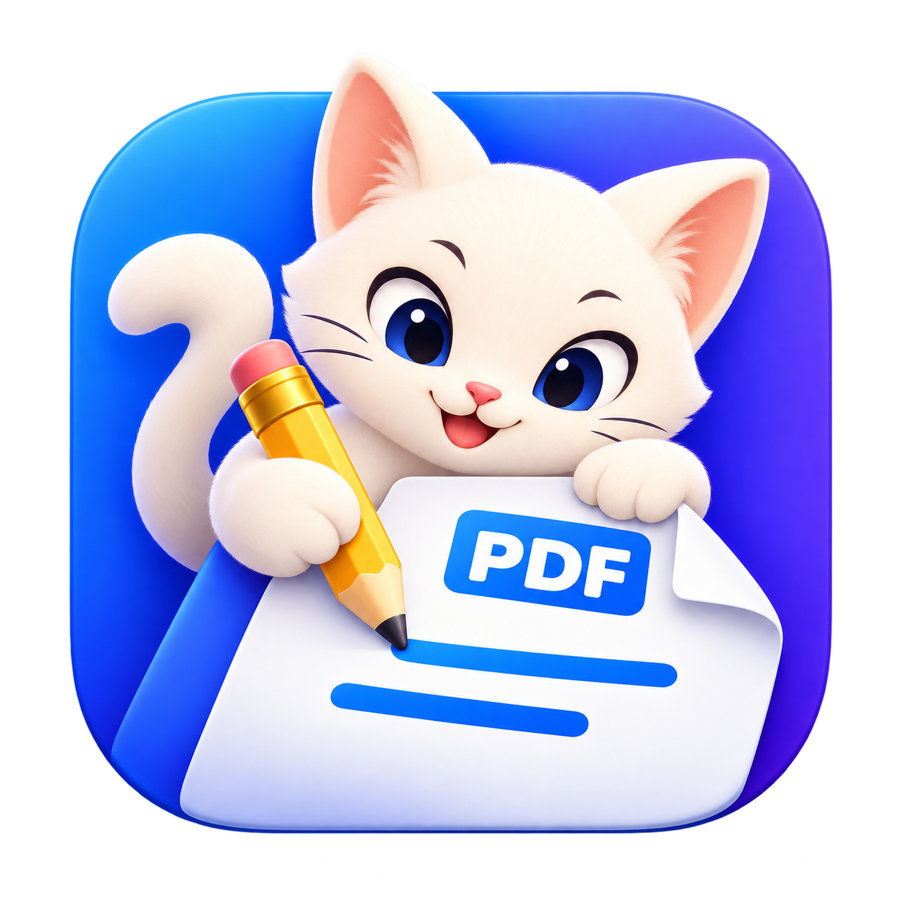

# MyPDF cat logo — concept 1

A warm-white cat edits a folded PDF page with a golden pencil, against MyPDF's existing blue-violet app tile. The large face, paper and pencil keep the concept recognizable at app-icon sizes.

Master: `MyPDF-cat-v1.png` (1254 × 1254 RGBA PNG with transparent surrounding margins).

Created with the built-in image-generation tool. This is the new artwork master; the currently installed application and existing platform icon assets are unchanged.

## Generation prompt

Use case: logo-brand.
Asset type: finished high-resolution macOS desktop app icon for MyPDF, a friendly but professional native PDF editor.
Primary request: an original appealing cat playfully editing a PDF document.
Make ONE beautifully composed square app icon, not a presentation board or collection. A confident little warm-white cat with a clean rounded silhouette, prominent triangular ears, a gently curling tail and an intent, cheerful expression is hugging/leaning over a large folded-corner PDF sheet. One paw holds a chunky golden-yellow pencil with its tip clearly touching a short blue editing stroke on the page. The other paw rests on the paper. The cat and paper must read as one compact memorable emblem, with a clear face and clean anatomy, no extra paws. The paper has a small crisp blue "PDF" label, exactly those three uppercase letters, and just two broad blue document marks.
Use the existing MyPDF blue-to-violet brand colors for a premium rounded-square tile behind the cream cat and white paper; dark indigo facial details and yellow pencil provide strong contrast. Restrained soft depth, rounded sculptural surfaces and extremely clean edges, like a carefully art-directed modern Mac icon. Charming, sophisticated, welcoming; no furry photorealism, no childish clip art, no stickers, no busy scene.
Composition: centered, balanced silhouette, face in upper half, document in lower half, pencil diagonal. Large simple forms visible at Dock sizes. Tile occupies about 82% of the square canvas; transparent surrounding margins, tiny natural contact shadow, no opaque backdrop outside the tile. Keep all elements within tile. No text outside the small PDF label, no app name, no mockup device, no watermark. Render at the highest practical square resolution with true alpha transparency outside the rounded tile.
